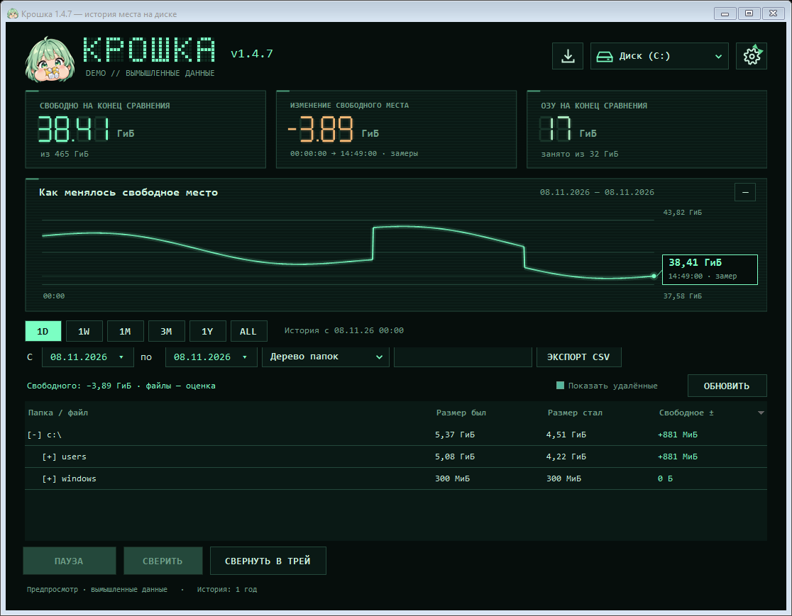
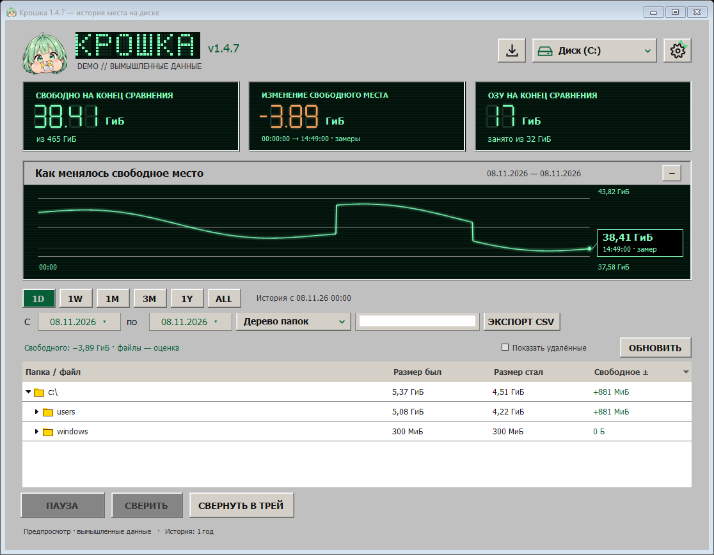
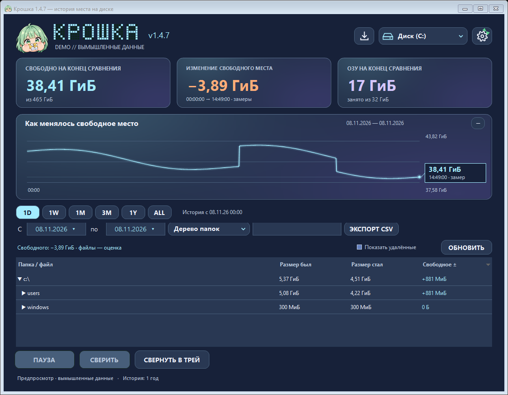

# Крошка

Крошка показывает, куда делось свободное место на диске. Вечером можно выбрать утренний замер, раскрыть папку Downloads и увидеть, сколько она занимала тогда и сколько занимает теперь. История хранится на компьютере в SQLite.

## Установка

Скачайте **Kroshka-Setup** из [последнего релиза](https://github.com/WintageOFFC/Kroshka/releases/latest) и запустите установщик. Версия для Windows 10/11 x64 включает .NET. После первого запуска нажмите **Начать наблюдение**. Крошка построит карту доступных файлов выбранного диска.

## Как читать историю

1. Выберите диск в правом верхнем углу. Под графиком выберите период или укажите две даты.
2. В режиме **Дерево папок** раскройте интересующую папку. «Размер был» и «Размер стал» относятся к выбранному периоду. В столбце «Свободное ±» плюс означает, что место освободилось.
3. Для поиска по имени переключитесь на **По файлам**. Двойной щелчок открывает подробности. Кнопка **Обновить** перечитывает историю из базы. **Сверить** запускает обход диска, например после долгого перерыва в наблюдении.
4. В дереве можно выделить несколько файлов через Shift или Ctrl. Правый щелчок открывает расположение или отправляет выбранные файлы в корзину после подтверждения. Место на диске освобождается при очистке корзины.

После первой карты Крошка слушает события файловой системы. Она записывает свободное место раз в минуту и группирует изменения файлов по пятиминутным интервалам. История хранится год. Пропуски при выключенном компьютере, недоступные папки и служебные данные Windows могут объяснять разницу между графиком и суммой размеров файлов.

Закрытие окна сворачивает приложение в трей. Чтобы завершить работу, выберите **Выйти** в меню значка. Для автозагрузки можно самостоятельно положить ярлык в папку `shell:startup`. Кнопка со стрелкой рядом с диском проверяет новые релизы на GitHub. При запуске проверка происходит в фоне.

## Оформление

Откройте шестерёнку с бантом и нажмите на портрет: Крошка в худи включает классическую тему, с дискетой — винтажную, с планшетом — современную. Галочка показывает текущий выбор. Ниже показаны винтажная и современная на одних и тех же демонстрационных данных.

| Винтаж | Модерн |
| --- | --- |
|  |  |

## Сборка

На Windows с .NET 8 SDK выполните `.\build.ps1` из PowerShell. Приложение появится в `app\Kroshka.exe`. Для запуска этой сборки требуется .NET 8 Desktop Runtime x64. Выпуск установщика описан в [.github/workflows/release.yml](.github/workflows/release.yml).

